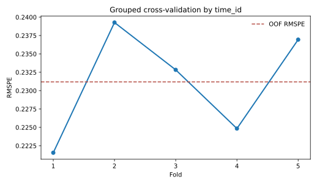
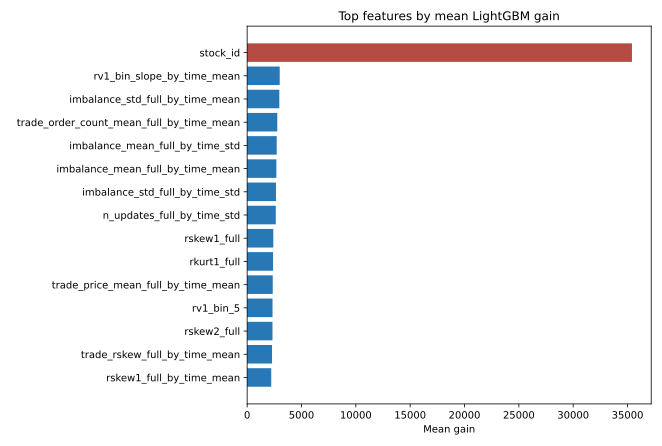

# Results

## Primary model

The primary model is a LightGBM regressor trained on `log(target)`. Predictions
are exponentiated and evaluated with RMSPE in the original target scale.

| Fold | RMSPE | Training rows | Validation rows | Best iteration |
|---:|---:|---:|---:|---:|
| 1 | 0.22155 | 343,145 | 85,787 | 2,977 |
| 2 | 0.23927 | 343,145 | 85,787 | 3,392 |
| 3 | 0.23283 | 343,146 | 85,786 | 3,274 |
| 4 | 0.22484 | 343,146 | 85,786 | 2,551 |
| 5 | 0.23694 | 343,146 | 85,786 | 3,379 |
| **Mean** | **0.23109** |  |  |  |
| **Pooled OOF** | **0.23119** |  |  |  |

The simple baseline averages the available full-window realized-volatility
features (`rv1_full`, `rv2_full`, and `trade_rv_full`) and fills missing values
with the training median. Its RMSPE is 0.49657. Relative to that definition, the
OOF result reduces RMSPE by 53.44%.

## Feature importance

The tracked feature table contains mean LightGBM gain across the five folds.
The top feature is `stock_id`, followed by time-bucket context, order imbalance,
trade-activity, and higher-moment features.

Gain importance does not establish causality. The dominance of `stock_id`
suggests that persistent stock-level volatility is materially useful. Because
the competition evaluates the same stock universe, this is allowed for the
primary objective, but it limits any claim about unseen-stock generalization.

## What the validation proves

- The same `time_id` does not appear in both sides of one fold.
- Model performance is measured on held-out market time buckets.
- Stock aggregates and missing-value fill values are fit using training-fold
  rows only.
- The reported OOF value pools one held-out prediction for every training row.

## What the validation does not prove

- It is not a calendar-ordered backtest.
- It does not test performance on previously unseen stocks.
- It does not model trading costs, latency, or execution.
- It is not a Kaggle public/private leaderboard score.
- The result cannot be regenerated without separately downloading the official
  competition data.

## Stock-ID sensitivity

The repository includes `scripts/run_stock_id_ablation.py`, which repeats the
same folds for the full model, without direct `stock_id`, and without both
direct identity and fold-fitted stock history. No ablation number is reported
here because the original stored experiment did not include those runs. This
avoids inventing a robustness result from feature importance alone.
